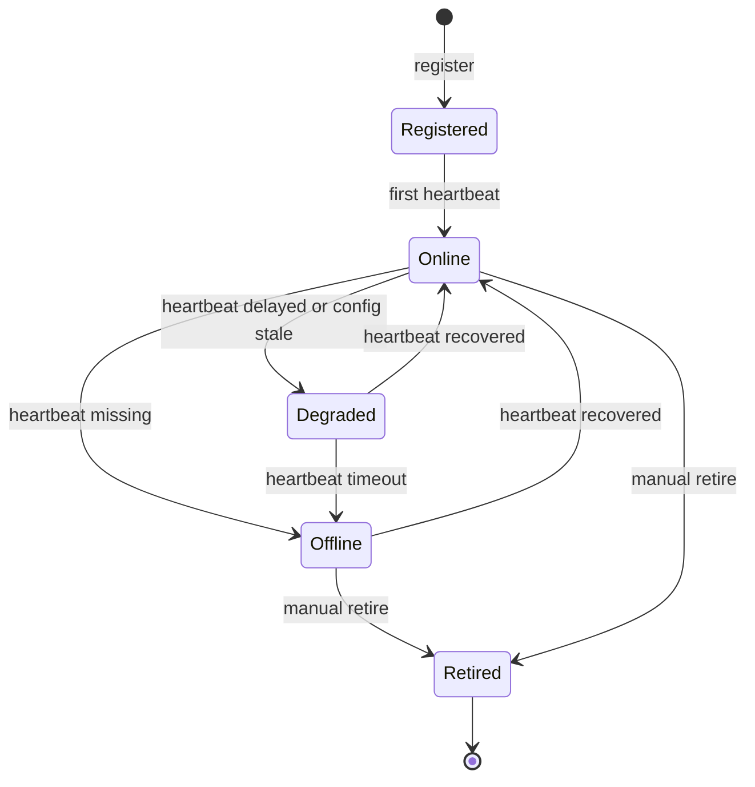
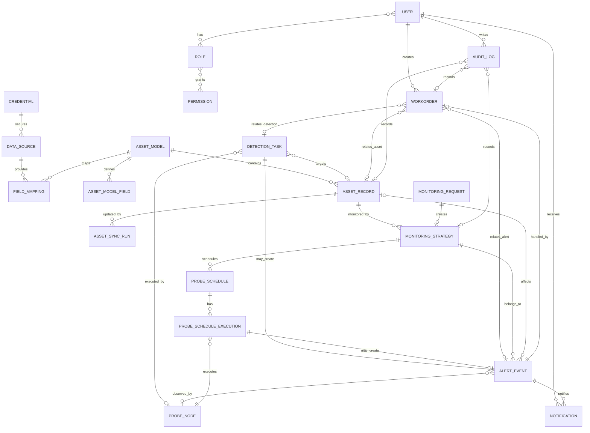

# OneAll 整个平台重构设计

> 归档说明：这是早期完整草案，只作为细节参考，不再作为当前重构基线。当前权威结论以 `README.md`、`01-product-redesign.md`、`02-frontend-antd-design.md`、`03-domain-and-refactor-boundaries.md` 和 `05-tasklist.md` 为准。  
> 已知过期点：技术栈、一级模块数量、任务清单可能与当前结论不一致。

> 状态：重构主设计草案  
> 日期：2026-05-25  
> 范围：整个平台，包括一次性检验、工单申请、资产中心、监控与告警、运维工具、系统设置、通知、数据源/凭据、权限、后台领域边界。  
> 文档策略：本文件只保留目标态需要的能力、业务逻辑和重构任务。`AI_CODEBASE_HANDOVER_REPORT.md` 作为代码库现状报告保留。

## 1. 重构目标

OneAll 重构目标：

> 以资产为数据底座，以拨测为执行链路，以告警和工单为闭环的一体化运维平台。

重构后用户应该能清楚完成这些事情：

- 做一次性检测。
- 申请长期监控。
- 查看和同步资产。
- 查看告警、策略、节点和日志。
- 使用轻量运维工具。
- 配置数据源、凭据、权限、通知和平台参数。

## 2. 目标一级导航

```text
一次性检验
工单申请
资产中心
监控与告警
运维工具
系统设置
```

### 2.1 登录后默认页面

重构版本不新增独立首页 / Dashboard。

登录成功后默认进入：

```text
监控与告警 / 监控总览
```

建议路由：

```text
/monitoring/overview
```

原因：

- OneAll 的主线是资产、检测、探针、告警、通知、工单闭环，不是大屏展示。
- 监控总览是运维人员进入平台后最需要优先看到的工作视角。
- 独立 Dashboard 容易变成各模块摘要堆叠，削弱主链路。

监控总览承担轻量工作台职责，展示粒度控制在：

- 当前活跃告警数。
- 严重告警数。
- 探针在线率。
- 监控策略健康状态。
- 最近告警事件。
- 最近探针异常。
- 快捷入口：新增监控策略、查看节点、查看告警。

全链路追踪不作为独立首页展示，而是作为详情页可钻取能力：

- 告警详情展示策略、探针、检测结果、通知和工单链路。
- 检测任务详情展示任务领取、执行、回传和告警判断链路。
- 资产详情展示资产同步、关联监控、关联告警和关联工单链路。

## 3. 平台主业务闭环

```text
资产数据
-> 一次性检测 / 监控申请
-> 探针执行
-> 检测结果
-> 告警事件
-> 通知
-> 工单处理
-> 审计留痕
```

## 4. 技术栈

| 层 | 技术 | 说明 |
| --- | --- | --- |
| 前端框架 | Vue 3、TypeScript、Vite | 控制台主应用 |
| 前端状态与路由 | Pinia、Vue Router | 登录态、权限、页面导航 |
| 前端 UI | Element Plus、Element Plus Icons | 管理后台组件体系 |
| 前端图表 | ECharts | 监控总览、趋势图 |
| 前端请求 | Axios | 统一 `apiClient` |
| 前端测试 | Vitest、Testing Library、Playwright | 单元测试和端到端验证 |
| 后端框架 | Python 3.11、Django 4.2、Django REST Framework | API 服务 |
| 后端异步 | Celery、Redis | 异步任务、调度、结果后端 |
| 后端数据库 | MySQL、PostgreSQL/TimescaleDB、SQLite 本地开发 | 业务数据、时序指标、本地调试 |
| 后端认证 | JWT、LDAP | 登录认证和企业目录接入 |
| 后端观测 | OpenTelemetry、python-json-logger | 链路与结构化日志 |
| 探针 | Go 1.21、gRPC、protobuf、zerolog、gopsutil | 探针 Agent 与资源采集 |
| 部署 | Docker Compose、Dockerfile、Nginx、Gunicorn | 本地与容器化部署 |

## 5. 前后端 API 契约

### 5.1 认证、用户与通知

| 页面/能力 | 方法 | API | 说明 |
| --- | --- | --- | --- |
| 登录 | `POST` | `/api/auth/login` | 用户名密码登录 |
| 当前用户 | `GET` | `/api/auth/profile` | 获取当前用户、角色、权限 |
| 修改密码 | `POST` | `/api/auth/change-password` | 修改当前用户密码 |
| 通知列表 | `GET` | `/api/notifications` | 站内通知列表 |
| 通知流 | `GET` | `/api/notifications/stream` | SSE 通知流 |
| 标记单条已读 | `POST` | `/api/notifications/{id}/read` | 通知已读 |
| 全部已读 | `POST` | `/api/notifications/mark-all-read` | 批量已读 |
| 审计日志 | `GET` | `/api/audit/logs` | 操作审计 |

### 5.2 一次性检验

| 页面/能力 | 方法 | API | 说明 |
| --- | --- | --- | --- |
| 发起一次性检测 | `POST` | `/api/detection/one-off` | 域名、证书、TCP 等检测 |
| 检测详情 | `GET` | `/api/detection/tasks/{id}` | 查询检测任务结果 |
| CMDB 域名校验 | `GET` | `/api/detection/cmdb/validate` | 校验域名是否存在于资产源 |

### 5.3 工单申请

| 页面/能力 | 方法 | API | 说明 |
| --- | --- | --- | --- |
| 提交工单 | `POST` | `/api/monitoring/requests` | 创建拨测监控申请 |
| 工单列表 | `GET` | `/api/monitoring/requests` | 查询申请列表 |
| 工单详情 | `GET` | `/api/monitoring/requests/{id}` | 查看申请详情 |
| 更新工单 | `PATCH` | `/api/monitoring/requests/{id}` | 修改申请内容 |
| 审批通过 | `POST` | `/api/monitoring/requests/{id}/approve` | 审批通过 |
| 驳回 | `POST` | `/api/monitoring/requests/{id}/reject` | 审批驳回 |
| 重新提交 | `POST` | `/api/monitoring/requests/{id}/resubmit` | 驳回后重新提交 |
| 状态回调 | `POST` | `/api/monitoring/requests/{id}/status` | 外部流程状态回写 |
| 执行历史 | `GET` | `/api/monitoring/tasks/history` | 监控任务历史 |

### 5.4 资产中心

| 页面/能力 | 方法 | API | 说明 |
| --- | --- | --- | --- |
| 资产查询 | `GET` | `/api/assets/records/query` | 资产列表、筛选、摘要 |
| 资产详情 | `GET` | `/api/assets/records/{id}` | 单条资产详情 |
| 新增资产 | `POST` | `/api/assets/records` | 手工新增资产 |
| 更新资产 | `PATCH` | `/api/assets/records/{id}` | 更新资产 |
| 批量导入 | `POST` | `/api/assets/import` | 导入资产 |
| 资产类型 | `GET` | `/api/assets/types` | 获取资产类型定义 |
| 更新资产类型 | `PATCH` | `/api/assets/types/{type_key}` | 更新唯一键、扩展字段 |
| 资产模型列表 | `GET` | `/api/assets/models` | 获取模型列表 |
| 创建资产模型 | `POST` | `/api/assets/models` | 创建模型 |
| 更新资产模型 | `PUT` | `/api/assets/models/{model_id}` | 更新模型和字段 |
| 模型同步 | `POST` | `/api/assets/models/{model_id}/sync` | 同步当前模型 |
| 同步预览 | `POST` | `/api/assets/models/{model_id}/sync/preview` | 预览变更 |
| 同步历史 | `GET` | `/api/assets/sync/runs` | 同步任务列表 |
| 同步详情 | `GET` | `/api/assets/sync/runs/{run_id}` | 同步详情和变更 |
| 同步重试 | `POST` | `/api/assets/sync/runs/{run_id}/retry` | 失败任务重试 |
| 资产关系图 | `GET` | `/api/assets/records/{id}/graph` | 单资产关系 |
| 按唯一键查图 | `GET` | `/api/assets/graph` | 按 `asset_type/canonical_key` 查询 |

### 5.5 监控与告警

| 页面/能力 | 方法 | API | 说明 |
| --- | --- | --- | --- |
| 监控总览 | `GET` | `/api/alerts/checks/system-overview` | 系统级监控概览 |
| 告警事件 | `GET` | `/api/alerts/events` | 告警事件列表 |
| 告警详情 | `GET` | `/api/alerts/events/{id}` | 告警事件详情 |
| 策略列表 | `GET` | `/api/alerts/checks` | 监控策略列表 |
| 创建策略 | `POST` | `/api/alerts/checks` | 创建监控策略 |
| 更新策略 | `PATCH` | `/api/alerts/checks/{id}` | 更新策略 |
| 删除策略 | `DELETE` | `/api/alerts/checks/{id}` | 删除策略 |
| 策略调度 | `GET` | `/api/alerts/checks/{id}/schedules` | 策略执行调度 |

### 5.6 探针节点

| 页面/能力 | 方法 | API | 说明 |
| --- | --- | --- | --- |
| 探针注册 | `POST` | `/api/probes/register/` | 探针首次注册 |
| 节点列表 | `GET` | `/api/probes/nodes/` | 查询探针节点 |
| 节点运行态 | `GET` | `/api/probes/nodes/{id}/runtime/` | 节点运行态 |
| 节点健康 | `GET` | `/api/probes/nodes/health/` | 节点健康摘要 |
| 节点指标历史 | `GET` | `/api/probes/nodes/{id}/metrics/history/` | 指标趋势 |
| 节点配置 | `GET/PUT` | `/api/probes/nodes/{id}/config/` | 查看和更新配置 |
| 配置版本 | `GET` | `/api/probes/nodes/{id}/config/versions/` | 配置版本列表 |
| 配置回滚 | `POST` | `/api/probes/nodes/{id}/config/rollback/` | 回滚配置 |
| 任务领取 | `POST` | `/api/probes/tasks/claim` | 探针领取一次性任务 |
| 任务结果 | `POST` | `/api/probes/tasks/{task_id}/result` | 一次性任务结果回传 |
| 调度结果 | `POST` | `/api/probes/schedules/{schedule_id}/result` | 持续调度结果回传 |

### 5.7 系统设置

| 页面/能力 | 方法 | API | 说明 |
| --- | --- | --- | --- |
| 公共品牌 | `GET` | `/api/public/branding` | 登录页和标题品牌 |
| 平台参数 | `GET/PUT` | `/api/settings/system` | 平台配置 |
| 权限目录 | `GET` | `/api/settings/permissions/catalog` | 权限矩阵 |
| 角色列表 | `GET` | `/api/settings/roles/` | 查询角色 |
| 创建角色 | `POST` | `/api/settings/roles/` | 创建角色 |
| 更新角色 | `PUT` | `/api/settings/roles/{id}/` | 更新角色 |
| 删除角色 | `DELETE` | `/api/settings/roles/{id}/` | 删除角色 |
| 用户列表 | `GET` | `/api/settings/users` | 用户和角色 |
| 创建用户 | `POST` | `/api/settings/users` | 创建本地用户 |
| 删除用户 | `DELETE` | `/api/settings/users/{id}` | 删除用户 |
| 更新用户角色 | `PUT` | `/api/settings/users/{id}/roles` | 分配角色 |
| LDAP 同步 | `POST` | `/api/settings/users/sync-ldap` | 同步 LDAP 用户 |
| 数据源列表 | `GET` | `/api/settings/data-sources/` | 数据源 |
| 创建数据源 | `POST` | `/api/settings/data-sources/` | 创建数据源 |
| 更新数据源 | `PUT` | `/api/settings/data-sources/{id}/` | 更新数据源 |
| 测试数据源 | `POST` | `/api/settings/data-sources/{id}/test/` | 连接测试 |
| 预览数据源 | `POST` | `/api/settings/data-sources/{id}/preview/` | 数据预览 |
| 凭据列表 | `GET` | `/api/settings/credentials/` | 凭据 |
| 创建凭据 | `POST` | `/api/settings/credentials/` | 创建凭据 |
| 更新凭据 | `PUT` | `/api/settings/credentials/{id}/` | 更新凭据 |
| 通知通道 | `GET` | `/api/settings/alerts/channels` | 通道列表 |
| 更新通道 | `PUT` | `/api/settings/alerts/channels/{type}` | 更新通道 |
| 测试通道 | `POST` | `/api/settings/alerts/channels/{type}/test` | 测试通道 |
| 通知模板 | `GET/POST` | `/api/settings/alerts/templates/` | 模板列表和创建 |
| 更新模板 | `PATCH` | `/api/settings/alerts/templates/{id}/` | 更新模板 |
| 删除模板 | `DELETE` | `/api/settings/alerts/templates/{id}/` | 删除模板 |

### 5.8 运维工具

| 页面/能力 | 方法 | API | 说明 |
| --- | --- | --- | --- |
| IP 转正则 | `POST` | `/api/tools/ip-regex/compile` | IP 列表生成正则 |
| 正则转 IP | `POST` | `/api/tools/ip-regex/expand` | 正则展开 IP |

### 5.9 平台级能力

重构目标 API 使用 `/api/v1` 作为版本前缀。当前文档中已有 `/api/...` 路径可作为存量兼容路径，重构实现时需要统一收敛到 `/api/v1/...`。

| 页面/能力 | 方法 | API | 说明 |
| --- | --- | --- | --- |
| 资产批量操作 | `POST` | `/api/v1/assets/records/batch` | 批量删除、下线、更新负责人等 |
| 策略批量操作 | `POST` | `/api/v1/monitoring/strategies/batch` | 批量启用、禁用、删除策略 |
| 告警批量操作 | `POST` | `/api/v1/alerts/events/batch` | 批量确认、关闭告警 |
| 工单批量操作 | `POST` | `/api/v1/workorders/requests/batch` | 批量审批、驳回 |
| 出站 Webhook 列表 | `GET` | `/api/v1/settings/webhooks` | 查询机器对接 Webhook |
| 创建出站 Webhook | `POST` | `/api/v1/settings/webhooks` | 创建 Webhook |
| 测试出站 Webhook | `POST` | `/api/v1/settings/webhooks/{id}/test` | 测试 Webhook 可用性 |
| Webhook 事件历史 | `GET` | `/api/v1/settings/webhooks/events` | 查询 Webhook 投递记录 |

## 6. API 契约原则

- 前端所有业务请求统一走 `frontend/src/app/api/apiClient.ts`。
- 重构目标后端业务 API 统一以 `/api/v1/` 开头。
- 存量 `/api/` 路径只作为兼容入口，不作为新接口设计标准。
- API 命名按业务域分组：`detection`、`monitoring`、`assets`、`alerts`、`probes`、`settings`、`tools`。
- 页面新增或重构时，先确定 API 表中的归属和契约，再实现页面。
- API 返回结构需要保持前端类型定义同步。
- 涉及权限的 API 必须在前端路由和后端权限中同时声明。

## 7. 目标页面地图

### 7.1 一次性检验

```text
一次性检验
├─ 域名拨测
├─ 证书检测
└─ CMDB 域名检测
```

定位：

> 临时、即时、低门槛的检测入口。

业务流程：

```text
输入目标
-> 选择检测类型
-> 选择探针
-> 执行检测
-> 查看结果
-> 查看关联资产
-> 转监控策略 / 发起工单
```

保留能力：

- 快速检测。
- 检测结果展示。
- 目标和资产匹配。
- 检测结果转监控策略。
- 检测结果发起工单。

### 7.2 工单申请

```text
工单申请
├─ 拨测监控申请
├─ 资产纳管申请
├─ 资产变更申请
├─ 我的申请
└─ 待我审批
```

定位：

> 所有需要审批、留痕、执行反馈的动作入口。

业务流程：

```text
提交申请
-> 自动校验
-> 审批
-> 执行
-> 结果回写
-> 通知申请人
-> 审计留痕
```

工单状态：

```text
草稿
待审批
已驳回
待执行
执行中
已完成
失败
已撤回
```

保留能力：

- 拨测监控申请。
- 资产纳管申请。
- 资产变更申请。
- 我的申请。
- 待我审批。
- 审批记录。
- 执行记录。
- 操作日志。

### 7.3 资产中心

```text
资产中心
├─ 全部资产
├─ 域名资产
├─ 主机资产
├─ 应用资产
├─ 项目资产
├─ 工单主机
└─ 自定义模型
```

定位：

> 多模型简单资产数据中心。

业务流程：

```text
选择模型
-> 查看资产数据
-> 同步数据
-> 查看同步结果
-> 管理员配置字段和映射
```

保留能力：

- 多模型资产数据。
- 模型字段配置。
- 字段映射。
- 数据源同步。
- 同步预览。
- 同步历史。
- 同步变更明细。
- 资产详情。

字段配置位置：

```text
当前模型页面 -> 字段配置抽屉
```

同步流程：

```text
选择数据源
-> 预览变更
-> 确认同步
-> 查看同步结果
```

### 7.4 监控与告警

```text
监控与告警
├─ 监控总览
├─ 告警事件
├─ 监控策略
├─ 节点
└─ 日志
```

定位：

> 持续监控运行态中心。

业务流程：

```text
资产 / 目标
-> 监控策略
-> 探针执行
-> 执行结果
-> 告警事件
-> 通知 / 工单
```

保留能力：

- 监控总览。
- 告警事件。
- 监控策略。
- 探针节点。
- 执行日志。
- 策略详情。
- 告警详情。
- 节点详情。

### 7.5 运维工具

```text
运维工具
└─ IP 正则助手
```

定位：

> 高频、轻量、独立的辅助工具。

保留能力：

- IP 列表生成正则。
- 正则展开 IP。
- 无需进入复杂配置即可使用。

### 7.6 系统设置

```text
系统设置
├─ 平台参数
├─ 用户与角色
├─ 权限矩阵
├─ 通知中心
├─ 集成配置
├─ 凭据管理
├─ 认证接入
└─ 审计日志
```

定位：

> 平台级配置中心。

保留能力：

- 平台参数。
- 用户与角色。
- 权限矩阵。
- 通知通道。
- 通知模板。
- 集成配置。
- 凭据管理。
- LDAP / 认证接入。
- 审计日志。

集成配置包括：

- 蓝鲸 CMDB。
- Zabbix。
- Grafana。
- LDAP。

## 8. 后台领域边界

```text
core
├─ 用户
├─ 权限
├─ 通知
├─ 审计
└─ 健康检查

settings
├─ 平台参数
├─ 数据源
├─ 凭据
├─ 集成配置
├─ 通知通道
└─ 通知模板

assets
├─ 资产模型
├─ 资产字段
├─ 资产记录
├─ 字段映射
├─ 同步任务
└─ 同步变更

monitoring
├─ 一次性检测
├─ 监控申请
├─ 监控任务
├─ 检测结果
└─ 执行历史

probes
├─ 探针节点
├─ 探针配置
├─ 心跳
├─ 运行指标
└─ 日志

alerts
├─ 告警策略
├─ 告警事件
├─ 告警执行
└─ 告警通知

tools
└─ IP 正则助手
```

### 8.1 领域边界规则

核心原则：

- 领域之间通过 API、服务接口或事件协作，不直接读写对方内部表。
- 前端页面按业务域调用 API，不跨模块拼装后端内部逻辑。
- 异步任务必须归属到明确领域，例如资产同步归属 `assets`，通知投递归属 `core/notifications` 或独立通知领域。
- 探针只执行任务和回传结果，不承载平台业务决策。
- 系统设置只管理配置、凭据、权限、通知通道，不承载资产同步业务本身。

允许依赖：

| 来源领域 | 可以依赖 | 说明 |
| --- | --- | --- |
| `assets` | `settings`、`core` | 读取数据源、凭据引用、审计和通知 |
| `monitoring` | `assets`、`probes`、`core` | 绑定资产、选择探针、写执行记录 |
| `probes` | `monitoring`、`alerts` | 领取任务、回传结果，结果进入告警判断 |
| `alerts` | `assets`、`monitoring`、`probes`、`core` | 关联资产、策略、探针、通知 |
| `workorders` | `assets`、`monitoring`、`alerts`、`core` | 工单关联业务对象和审批通知 |
| `settings` | `core` | 权限、审计、用户上下文 |
| `tools` | 无业务依赖 | 只提供轻量工具能力 |

禁止依赖：

- `assets` 不直接写告警事件。
- `alerts` 不直接修改资产字段。
- `probes` 不直接创建工单。
- `settings` 不直接执行同步任务。
- `tools` 不承载资产、监控、告警、工单业务。
- 前端页面不绕过统一 API 客户端直接访问多个模块内部实现。

### 8.2 跨领域事件

跨领域协作优先使用事件表达。

建议事件：

| 事件 | 生产者 | 消费者 | 用途 |
| --- | --- | --- | --- |
| `asset.sync.started` | `assets` | `core/notifications` | 通知同步开始 |
| `asset.sync.completed` | `assets` | `core/notifications`、`audit` | 通知同步完成并留痕 |
| `asset.sync.failed` | `assets` | `core/notifications`、`audit` | 通知同步失败 |
| `monitoring.strategy.enabled` | `monitoring` | `probes`、`audit` | 触发探针调度配置更新 |
| `probe.result.received` | `probes` | `alerts`、`monitoring` | 进入结果归档和告警判断 |
| `alert.event.created` | `alerts` | `core/notifications`、`workorders` | 通知和工单处理 |
| `workorder.completed` | `workorders` | `alerts`、`audit` | 回写处理结果 |

### 8.3 跨领域事件投递方案

重构初期采用 Celery 任务链作为事件投递方式，不优先引入新的 MQ。

原因：

- 当前平台已有 Celery 和 Redis 基础。
- 资产同步、通知投递、告警处理天然适合异步任务。
- 在业务边界没有完全稳定前，先减少基础设施复杂度。

事件投递原则：

- 业务主流程只写本领域状态和事件记录，不同步等待跨领域消费者完成。
- 事件消费者失败后进入重试，超过重试次数后记录失败并通知管理员。
- 每个事件携带 `event_id`、`trace_id`、`event_type`、`producer`、`payload`、`created_at`。
- 事件处理必须幂等，消费者使用 `event_id` 或业务唯一键防止重复执行。

事件投递表：

| 事件 | 投递方式 | 消费者 | 失败处理 |
| --- | --- | --- | --- |
| `asset.sync.started` | Celery async task | 通知服务、审计服务 | 重试 3 次，失败写事件失败表 |
| `asset.sync.completed` | Celery async task | 通知服务、审计服务 | 重试 3 次，失败可人工补发通知 |
| `asset.sync.failed` | Celery async task | 通知服务、审计服务 | 重试 3 次，失败升级为系统告警 |
| `monitoring.strategy.enabled` | Celery async task | 探针调度配置服务、审计服务 | 重试 3 次，失败保持策略为待下发 |
| `probe.result.received` | Celery async task | 结果归档服务、告警判断服务 | 重试 3 次，失败进入结果处理死信 |
| `alert.event.created` | Celery async task | 通知服务、工单服务 | 重试 3 次，失败保留告警但标记通知失败 |
| `workorder.completed` | Celery async task | 告警服务、审计服务 | 重试 3 次，失败保留工单完成状态并记录补偿任务 |

后续演进：

- 单机或小规模部署继续使用 Celery + Redis。
- 如果事件量明显增长，再评估 RabbitMQ、Kafka 或 Redis Streams。
- Django Signals 只允许用于进程内轻量钩子，不作为跨领域事件总线。

## 9. 总体数据链路

### 9.1 资产同步链路

```text
系统设置：数据源 / 凭据
-> 资产中心：模型字段 / 映射
-> 同步预览
-> 同步执行
-> 资产记录
-> 同步历史
-> 全局通知
```

### 9.2 拨测链路

```text
一次性检验 / 监控策略
-> 探针节点
-> 执行结果
-> 监控结果
-> 告警判断
-> 告警事件
-> 通知 / 工单
```

### 9.3 工单链路

```text
用户提交
-> 资产/目标校验
-> 审批
-> 执行
-> 结果回写
-> 通知
-> 审计
```

### 9.4 通知链路

```text
系统事件
-> 通知服务
-> 站内通知
-> 外部通道
-> 点击跳转详情
```

通知事件：

- 资产同步完成 / 失败。
- 工单审批 / 驳回 / 完成。
- 告警产生 / 恢复。
- 探针离线 / 恢复。
- 数据源连接失败。
- 权限或平台配置变更。

## 10. 权限模型

```text
detection.oneoff.view
detection.oneoff.execute

workorders.requests.view
workorders.requests.create
workorders.requests.approve
workorders.requests.execute

assets.records.view
assets.records.manage
assets.models.manage
assets.sync.view
assets.sync.execute

monitoring.overview.view
monitoring.policies.view
monitoring.policies.manage

alerts.events.view
alerts.checks.view
alerts.checks.manage

probes.nodes.view
probes.nodes.manage
probes.logs.view

tools.ip_regex.view
tools.ip_regex.execute

settings.system.view
settings.system.manage
settings.integrations.manage
settings.credentials.manage
settings.notifications.manage
settings.audit_log.view
```

## 11. 业务逻辑对齐

### 11.1 一次性检验

现有代码入口：

- `backend/src/apps/monitoring/api/one_off_detection_view.py`
- `backend/src/apps/monitoring/services/detection_service.py`
- `backend/src/apps/monitoring/models/detection_task.py`
- `frontend/src/features/detection/pages/OneOffDetectionPage.vue`
- `frontend/src/features/detection/pages/CertificateDetectionPage.vue`
- `frontend/src/features/detection/pages/CmdbDomainCheckPage.vue`

核心实体：

- `DetectionTask`
- `ProbeNode`

核心 API：

- `POST /api/detection/one-off`
- `POST /api/probes/tasks/claim`
- `POST /api/probes/tasks/<task_id>/result`

目标对齐：

- 检测创建保留 `DetectionTask`。
- 检测执行保留探针 claim/result 链路。
- 检测结果统一展示。
- 检测目标匹配 `AssetRecord`。
- 检测结果支持转监控和发起工单。

### 11.2 工单申请

现有代码入口：

- `backend/src/apps/monitoring/models/monitoring_request.py`
- `backend/src/apps/monitoring/api/monitoring_request_view.py`
- `backend/src/apps/monitoring/api/monitoring_approval_view.py`
- `backend/src/apps/monitoring/services/request_workflow_service.py`
- `frontend/src/features/monitoring/pages/MonitoringRequestFormPage.vue`

核心实体：

- `MonitoringRequest`
- `MonitoringJob`
- `ProbeSchedule`

目标对齐：

- `MonitoringRequest` 承接拨测监控申请。
- 工单详情展示审批记录、执行记录和操作日志。
- 工单结果进入通知和审计。
- 检测、资产、告警都可以发起工单。

### 11.3 资产中心

现有代码入口：

- `backend/src/apps/assets/models/asset_model.py`
- `backend/src/apps/assets/models/asset_record.py`
- `backend/src/apps/assets/models/asset_sync_run.py`
- `backend/src/apps/assets/models/asset_sync_change.py`
- `backend/src/apps/assets/services/sync_service.py`
- `backend/src/apps/assets/services/field_mapping_service.py`
- `frontend/src/features/assets/pages/AssetCenterPage.vue`
- `frontend/src/features/assets/pages/AssetModelCenterPage.vue`
- `frontend/src/features/assets/pages/AssetModelAdminPage.vue`

核心实体：

- `AssetModel`
- `AssetField`
- `AssetRecord`
- `AssetSyncRun`
- `AssetSyncChange`
- `DataSource`
- `Credential`

目标对齐：

- 模型就是一张资产表。
- 字段配置服务当前模型。
- 同步历史按当前模型过滤。
- `AssetModel/AssetRecord/AssetSyncRun/AssetSyncChange` 作为核心数据结构保留。

### 11.4 监控与告警

现有代码入口：

- `backend/src/apps/alerts/models/*`
- `backend/src/apps/alerts/services/*`
- `backend/src/apps/probes/models/probe_node.py`
- `backend/src/apps/probes/models/probe_schedule.py`
- `backend/src/apps/probes/models/probe_schedule_execution.py`
- `frontend/src/features/alerts/pages/AlertEvents.vue`
- `frontend/src/features/alerts/pages/AlertChecks.vue`
- `frontend/src/features/probes/pages/ProbeManagerPage.vue`
- `frontend/src/features/probes/pages/ProbeLogsPage.vue`

核心实体：

- `AlertCheck`
- `AlertSchedule`
- `AlertEvent`
- `ProbeNode`
- `ProbeSchedule`
- `ProbeScheduleExecution`

目标对齐：

- 策略包含监控对象、检测频率、探针范围、告警条件。
- 节点包含状态、心跳、配置版本、运行任务。
- 告警事件包含触发对象、等级、状态、恢复、通知。
- 日志包含任务、节点、执行结果、错误。

### 11.5 运维工具

现有代码入口：

- `frontend/src/features/tools/pages/IpRegexHelperPage.vue`
- `backend/src/apps/tools/services/ip_regex_runner.py`

目标对齐：

- 运维工具只承载 IP 正则助手。
- IP 正则保留前端页面和后端固定服务能力。

### 11.6 系统设置

现有代码入口：

- `backend/src/apps/settings/models/*`
- `backend/src/apps/settings/api/urls.py`
- `frontend/src/features/settings/pages/*`
- `frontend/src/features/integrations/pages/IntegrationPlaceholderPage.vue`

目标对齐：

- 平台参数管理品牌、展示、运行参数。
- 用户与角色管理账号、角色、授权。
- 权限矩阵管理模块权限和操作权限。
- 通知中心管理通道、模板、通知策略。
- 集成配置管理蓝鲸 CMDB、Zabbix、Grafana、LDAP。
- 凭据管理密钥、token、账号密码。
- 审计日志展示操作留痕。

## 12. 跨模块关系矩阵

| 来源模块 | 目标模块 | 关系 | 业务说明 |
| --- | --- | --- | --- |
| 资产中心 | 一次性检验 | 资产匹配 | 检测目标命中资产后展示资产信息 |
| 一次性检验 | 工单申请 | 发起工单 | 检测失败后创建处理申请 |
| 一次性检验 | 监控与告警 | 转监控 | 检测目标转为长期监控策略 |
| 资产中心 | 监控与告警 | 监控对象 | 监控策略可绑定资产 |
| 监控与告警 | 工单申请 | 告警处理 | 告警事件发起处理工单 |
| 系统设置 | 资产中心 | 数据源/凭据 | 资产同步读取系统设置中的数据源和凭据 |
| 系统设置 | 监控与告警 | 通知通道 | 告警投递使用通知通道 |
| 系统设置 | 工单申请 | 通知/权限 | 审批通知和工单权限来自系统设置 |
| 运维工具 | 资产中心 | 辅助输入 | IP 正则可辅助资产 IP 范围处理 |

## 13. 资产中心细化设计

### 13.1 高保真方向


### 13.2 资产字段扩展模型

资产字段不做全量内置，也不让外部系统字段直接污染平台模型。

目标设计：

```text
平台标准字段
-> 模型自定义字段
-> 外部字段映射
```

原则：

- 标准字段只保留平台通用链路需要的字段。
- 每类资产的差异字段通过模型字段配置扩展。
- 蓝鲸 CMDB、Zabbix、Excel、API 等外部字段必须先经过字段映射，再进入 OneAll 资产模型。
- 监控、告警、工单、搜索、权限优先依赖标准字段。
- 特定业务页面和同步规则使用自定义字段。

标准字段建议：

| 字段 | 说明 |
| --- | --- |
| `id` | 资产唯一 ID |
| `model_key` | 资产模型标识 |
| `name` | 资产名称 |
| `primary_ip` | 主 IP |
| `owner` | 负责人 |
| `status` | 资产状态 |
| `source_type` | 来源类型，例如 `blueking_cmdb`、`zabbix`、`manual` |
| `source_id` | 外部系统原始 ID |
| `last_sync_at` | 最近同步时间 |
| `created_at` | 创建时间 |
| `updated_at` | 更新时间 |

自定义字段示例：

| 模型 | 自定义字段示例 |
| --- | --- |
| 域名资产 | `domain_name`、`record_type`、`provider`、`ssl_expire_at` |
| 主机资产 | `os_name`、`cloud_area`、`cpu_cores`、`memory_gb`、`bk_host_id` |
| 数据库资产 | `engine`、`version`、`instance_id`、`cluster_name` |
| 证书资产 | `common_name`、`issuer`、`expire_at`、`bind_domain` |

字段定义建议：

| 字段 | 说明 |
| --- | --- |
| `field_key` | 字段唯一键 |
| `field_name` | 展示名称 |
| `field_type` | 字段类型 |
| `required` | 是否必填 |
| `unique` | 是否唯一 |
| `searchable` | 是否可搜索 |
| `display_in_list` | 是否列表展示 |
| `editable` | 是否允许手工编辑 |
| `source_policy` | 字段来源策略，例如同步优先、手工优先、只读 |
| `validation_rule` | 校验规则 |
| `options` | 枚举或扩展配置 |
| `sort_order` | 展示顺序 |

存储建议：

```text
asset_models
asset_model_fields
asset_records
asset_field_mappings
asset_sync_runs
```

其中 `asset_records` 保留标准字段真实列，自定义字段使用 `custom_fields` 承载。PostgreSQL 场景优先使用 `JSONB`，高频查询字段再增加索引。

### 13.3 模型资产页

以“域名资产”为例，页面包含：

- 标题：域名资产。
- 资产总数。
- 最近同步时间。
- 当前数据源。
- 字段映射完整度。
- 同步数据。
- 字段配置。
- 同步历史。
- 搜索和筛选。
- 动态资产表格。

### 13.4 字段配置抽屉

字段配置在当前模型页右上角打开。

抽屉内容：

- 当前模型名称。
- 字段名。
- 显示名。
- 字段类型。
- 是否必填。
- 是否唯一。
- 来源字段映射。
- 是否展示。
- 展示顺序。
- 字段来源策略。
- 校验规则。

操作：

- 保存配置。
- 预览映射。

## 14. 核心领域对象字段契约

本节记录重构版本必须稳定下来的产品级字段契约。这里不是最终数据库 DDL，而是前端页面、后端 API、数据表设计和链路追踪必须共同遵守的业务对象边界。

### 14.1 探针节点

用途：平台执行拨测、采集和任务回传的节点。

关键字段：

| 字段 | 说明 |
| --- | --- |
| `node_id` | 探针节点唯一 ID |
| `name` | 节点名称 |
| `hostname` | 主机名 |
| `ip` | 节点 IP |
| `region` | 地域 |
| `network_type` | 网络类型，例如内网、外网、专线 |
| `version` | 探针版本 |
| `capabilities` | 探针能力列表 |
| `labels` | 节点标签 |
| `status` | 在线、离线、异常 |
| `last_heartbeat_at` | 最近心跳时间 |
| `config_version` | 当前生效配置版本 |

关联关系：

- 一个探针节点可以领取多个检测任务。
- 一个检测结果必须关联一个探针节点。
- 告警详情需要能追溯到执行探针。

### 14.2 探针能力

用途：描述探针能执行哪些检测和采集动作。

关键字段：

| 字段 | 说明 |
| --- | --- |
| `capability_key` | 能力标识，例如 `http_check`、`tcp_check`、`ping_check` |
| `name` | 能力名称 |
| `category` | 能力分类 |
| `enabled` | 是否启用 |
| `config_schema` | 能力配置结构 |
| `result_schema` | 结果结构 |

### 14.3 探针配置版本

用途：保证探针配置可追踪、可回滚、可审计。

关键字段：

| 字段 | 说明 |
| --- | --- |
| `config_id` | 配置 ID |
| `node_id` | 关联探针 |
| `version` | 配置版本 |
| `content` | 配置内容 |
| `status` | 草稿、已发布、已回滚 |
| `published_at` | 发布时间 |
| `published_by` | 发布人 |
| `checksum` | 配置校验值 |

### 14.3.1 探针生命周期和异常处理

探针状态流转：



建议阈值：

| 场景 | 建议策略 |
| --- | --- |
| 心跳间隔 | 探针每 30 秒上报一次心跳 |
| 异常判定 | 连续 2 个心跳周期未上报，标记 `Degraded` |
| 离线判定 | 连续 5 分钟无心跳，标记 `Offline` |
| 任务领取超时 | 任务被领取后超过 `timeout_seconds + 30s` 未回传，标记超时 |
| 结果回传超时 | 调度执行超过策略 `timeout_seconds`，进入失败判断 |
| 配置版本过期 | 探针心跳携带旧版本时，返回最新配置版本和拉取地址 |

异常处理：

- 探针离线后，已领取但未完成的任务标记为超时，并根据策略决定是否重新分配。
- 一次性检测任务可以重新分配给其他满足能力的在线探针。
- 持续监控策略根据 `probe_selector` 自动选择其他可用探针。
- 如果没有可用探针，调度执行标记为 `no_available_probe`，并生成平台告警。
- 探针长期不可用时，管理员可以将节点退役；退役节点不再参与调度。
- 探针上报过期配置版本时，不直接拒绝任务，但必须触发配置更新流程。

### 14.4 检测任务与执行结果

用途：承载一次性检测和持续监控调度的执行链路。

关键字段：

| 字段 | 说明 |
| --- | --- |
| `task_id` | 任务 ID |
| `trace_id` | 全链路追踪 ID |
| `task_type` | 一次性检测或持续调度 |
| `check_type` | HTTP、TCP、PING、DNS、SSL 等 |
| `target` | 检测目标 |
| `asset_id` | 关联资产 |
| `strategy_id` | 关联监控策略 |
| `node_id` | 执行探针 |
| `status` | 待领取、执行中、成功、失败、超时 |
| `started_at` | 开始时间 |
| `finished_at` | 结束时间 |
| `latency_ms` | 延迟 |
| `error_code` | 错误码 |
| `error_message` | 错误信息 |
| `raw_output` | 原始输出 |

### 14.5 监控策略

用途：定义哪些目标需要长期监控、如何调度、何时触发告警。

关键字段：

| 字段 | 说明 |
| --- | --- |
| `strategy_id` | 策略 ID |
| `name` | 策略名称 |
| `check_type` | 检测类型 |
| `target` | 检测目标 |
| `asset_id` | 关联资产 |
| `probe_selector` | 探针选择规则 |
| `interval_seconds` | 检测间隔 |
| `timeout_seconds` | 超时时间 |
| `retry_count` | 重试次数 |
| `enabled` | 是否启用 |
| `alert_rule` | 告警规则 |
| `created_by` | 创建人 |
| `created_at` | 创建时间 |

告警规则 DSL 草案：

```json
{
  "version": "v1",
  "condition": {
    "all": [
      {
        "metric": "latency_ms",
        "operator": ">",
        "value": 2000,
        "duration": "3m"
      },
      {
        "metric": "http_status",
        "operator": "!=",
        "value": 200
      }
    ]
  },
  "trigger": {
    "consecutive_failures": 3,
    "evaluation_window": "5m"
  },
  "suppress": {
    "dedup_key": ["strategy_id", "target", "check_type"],
    "silence_for": "5m"
  },
  "schedule": {
    "timezone": "Asia/Shanghai",
    "active_windows": ["09:00-18:00"]
  },
  "severity": "critical"
}
```

规则能力：

- 阈值规则，例如响应时间大于 2000ms。
- 连续失败次数，例如连续 3 次失败才告警。
- 多条件组合，例如 HTTP 状态码非 200 且延迟大于 1000ms。
- 波动规则，例如相比最近 5 分钟均值偏差大于 50%。
- 告警静默期，例如同一策略 5 分钟内不重复通知。
- 时间段规则，例如只在业务时段告警。

判断流程：

```text
探针结果回传
-> 结果标准化
-> 找到监控策略
-> 读取 alert_rule
-> 按 evaluation_window 取历史结果
-> 判断 condition
-> 计算 dedup_key
-> 判断静默期
-> 创建或更新告警事件
-> 触发通知 / 工单
```

### 14.6 告警事件

用途：记录监控结果产生的异常事件，并支撑通知、工单和排障。

关键字段：

| 字段 | 说明 |
| --- | --- |
| `event_id` | 告警事件 ID |
| `trace_id` | 全链路追踪 ID |
| `dedup_key` | 告警去重键 |
| `severity` | 告警级别 |
| `status` | 活跃、已恢复、已确认、已关闭 |
| `asset_id` | 关联资产 |
| `strategy_id` | 关联策略 |
| `node_id` | 关联探针 |
| `task_id` | 关联检测任务 |
| `title` | 告警标题 |
| `description` | 告警描述 |
| `first_seen_at` | 首次发生时间 |
| `last_seen_at` | 最近发生时间 |
| `recovered_at` | 恢复时间 |
| `notification_status` | 通知状态 |
| `workorder_id` | 关联工单 |

### 14.7 工单申请

用途：承载监控开通、资产纳管、告警处理等需要审批和留痕的动作。

关键字段：

| 字段 | 说明 |
| --- | --- |
| `request_id` | 工单 ID |
| `request_type` | 申请类型 |
| `title` | 工单标题 |
| `content` | 申请内容 |
| `applicant_id` | 申请人 |
| `approver_id` | 审批人 |
| `status` | 草稿、待审批、已通过、已驳回、执行中、已完成 |
| `approval_records` | 审批记录 |
| `execution_status` | 执行状态 |
| `execution_result` | 执行结果 |
| `asset_id` | 关联资产 |
| `alert_event_id` | 关联告警 |
| `task_id` | 关联检测任务 |
| `created_at` | 创建时间 |
| `updated_at` | 更新时间 |

### 14.8 数据源

用途：统一管理蓝鲸 CMDB、Zabbix、LDAP、Grafana 等外部系统接入。

关键字段：

| 字段 | 说明 |
| --- | --- |
| `data_source_id` | 数据源 ID |
| `name` | 数据源名称 |
| `source_type` | 数据源类型 |
| `base_url` | 接入地址 |
| `credential_id` | 关联凭据 |
| `scope` | 同步范围 |
| `enabled` | 是否启用 |
| `sync_policy` | 同步策略 |
| `last_test_status` | 最近测试状态 |
| `last_sync_at` | 最近同步时间 |

### 14.9 凭据

用途：统一保存外部系统账号、Token、密钥等敏感信息。

关键字段：

| 字段 | 说明 |
| --- | --- |
| `credential_id` | 凭据 ID |
| `name` | 凭据名称 |
| `credential_type` | 凭据类型 |
| `secret_ref` | 密文引用 |
| `owner_id` | 所有人 |
| `expires_at` | 过期时间 |
| `last_used_at` | 最近使用时间 |
| `status` | 启用、禁用、过期 |

### 14.10 字段映射模板

用途：把外部系统字段转换为 OneAll 标准字段或模型自定义字段。

关键字段：

| 字段 | 说明 |
| --- | --- |
| `mapping_id` | 映射 ID |
| `model_key` | 资产模型 |
| `data_source_id` | 数据源 |
| `external_field` | 外部字段 |
| `target_field` | OneAll 字段 |
| `transform_rule` | 转换规则 |
| `required` | 是否必填 |
| `default_value` | 默认值 |
| `enabled` | 是否启用 |

### 14.11 通知渠道与通知消息

用途：承载告警、工单、同步结果等事件通知。

关键字段：

| 对象 | 字段 | 说明 |
| --- | --- | --- |
| 通知渠道 | `channel_id` | 渠道 ID |
| 通知渠道 | `channel_type` | 站内信、邮件、企业微信、飞书等 |
| 通知渠道 | `config` | 渠道配置 |
| 通知渠道 | `enabled` | 是否启用 |
| 通知消息 | `notification_id` | 通知 ID |
| 通知消息 | `receiver_id` | 接收人 |
| 通知消息 | `event_type` | 事件类型 |
| 通知消息 | `title` | 标题 |
| 通知消息 | `content` | 内容 |
| 通知消息 | `read_at` | 已读时间 |
| 通知消息 | `target_url` | 跳转地址 |

### 14.12 用户、角色与权限

用途：控制用户可访问的页面、API 和业务数据范围。

关键字段：

| 对象 | 字段 | 说明 |
| --- | --- | --- |
| 用户 | `user_id` | 用户 ID |
| 用户 | `username` | 登录名 |
| 用户 | `display_name` | 展示名 |
| 用户 | `email` | 邮箱 |
| 用户 | `status` | 启用、禁用 |
| 角色 | `role_id` | 角色 ID |
| 角色 | `role_key` | 角色标识 |
| 角色 | `name` | 角色名称 |
| 权限 | `permission_key` | 权限点 |
| 权限 | `scope` | 数据范围 |

### 14.13 审计日志

用途：记录关键配置、资产、策略、工单和权限操作。

关键字段：

| 字段 | 说明 |
| --- | --- |
| `audit_id` | 审计 ID |
| `actor_id` | 操作人 |
| `action` | 操作动作 |
| `resource_type` | 资源类型 |
| `resource_id` | 资源 ID |
| `before` | 变更前内容 |
| `after` | 变更后内容 |
| `ip` | 操作来源 IP |
| `user_agent` | 客户端信息 |
| `created_at` | 操作时间 |

### 14.14 核心实体 ER 关系图

本图用于约束核心实体关系，不等同于最终数据库 DDL。



关系约定：

- `MonitoringRequest` 是申请单，审批通过后生成或更新 `MonitoringStrategy`。
- `MonitoringStrategy` 是长期监控策略，负责生成 `ProbeSchedule`。
- `ProbeSchedule` 是策略的调度配置，`ProbeScheduleExecution` 是每次调度执行记录。
- `DetectionTask` 表示一次性检测任务，不和 `ProbeScheduleExecution` 合并成一张表。
- `AlertEvent` 可以由一次性检测任务或持续调度执行产生，但必须能追溯到策略、资产、探针和 `trace_id`。

## 15. 重构关键注意事项

### 15.1 不做成低代码平台

资产字段和字段映射可以配置，但平台主链路必须固定。

固定链路：

```text
资产
-> 监控策略 / 一次性检测
-> 探针执行
-> 检测结果
-> 告警事件
-> 通知 / 工单
-> 审计
```

边界：

- 配置化只解决字段差异、数据源差异和通知渠道差异。
- 资产、监控、探针、告警、工单、通知这些核心领域对象不配置化。
- 页面操作、状态机和 API 契约必须明确，不通过动态配置临时拼业务。

### 15.2 `trace_id` 从第一天设计

每条核心链路必须携带 `trace_id`。

需要贯穿：

- 资产同步任务。
- 一次性检测任务。
- 监控策略调度。
- 探针任务领取。
- 检测结果回传。
- 告警事件生成。
- 通知投递。
- 工单处理。
- 审计记录。

目标：

- 用户能从告警反查检测结果、探针、策略、资产和工单。
- 管理员能从同步失败反查数据源、字段映射、执行记录和通知记录。
- 后端日志、API 响应、异步任务和探针回传使用同一个链路标识。

### 15.3 外部系统字段不能直接污染核心模型

蓝鲸 CMDB、Zabbix、LDAP、Grafana、Excel、API 都是数据源，不是 OneAll 的核心模型。

正确路径：

```text
外部字段
-> 字段映射模板
-> OneAll 标准字段 / 模型自定义字段
```

约束：

- 外部字段名不直接作为平台标准字段。
- 外部系统 ID 保存在 `source_id` 或自定义字段中。
- 外部系统变更时，只调整数据源和字段映射，不改核心链路。

### 15.4 配置和凭据必须分开

数据源、通知渠道、LDAP、蓝鲸 CMDB、Zabbix 等配置不能直接保存明文密钥。

正确关系：

```text
数据源配置
-> 关联凭据
-> 密文引用
```

约束：

- 凭据有独立权限。
- 凭据变更必须审计。
- 凭据支持禁用、过期、轮换。
- API 返回不能包含明文密钥。

### 15.5 状态机要统一

工单、同步任务、检测任务、告警事件都必须有明确状态机。

建议状态：

| 对象 | 状态 |
| --- | --- |
| 工单 | 草稿、待审批、已通过、已驳回、执行中、已完成、已取消 |
| 同步任务 | 待执行、执行中、成功、失败、部分成功、已取消 |
| 检测任务 | 待领取、执行中、成功、失败、超时 |
| 告警事件 | 活跃、已确认、已恢复、已关闭 |

约束：

- 前端展示、后端 API、通知文案、审计日志使用同一套状态。
- 状态变化必须记录操作者、时间和原因。
- 失败状态必须能看到错误码和错误信息。

### 15.6 前端先定对象和动作，再做页面

页面不是先画出来，而是先明确管理对象和用户动作。

每个页面必须回答：

- 管理哪个对象。
- 用户能做哪些动作。
- 动作对应哪个 API。
- 成功后对象状态怎么变。
- 失败后错误如何展示。
- 是否产生通知。
- 是否产生审计。

约束：

- 页面不能绕过统一 API 客户端。
- 页面不能自行拼接复杂业务规则。
- 表格、筛选、详情、抽屉、状态标签的交互风格必须统一。

### 15.7 数据迁移策略

重构采用分阶段迁移，不在第一阶段强行重建所有数据表。

阶段策略：

| 阶段 | 策略 | 说明 |
| --- | --- | --- |
| 第一阶段 | 代码结构和页面重构，数据保持原地 | 先稳定产品边界、API 契约和页面体验 |
| 第二阶段 | 新旧字段映射和兼容读取 | 新 API 输出目标字段，内部可从旧表转换 |
| 第三阶段 | 后台迁移任务 | 批量迁移资产、检测、告警、工单历史数据 |
| 第四阶段 | 双读校验 | 新旧数据同时读取比对，确认一致性 |
| 第五阶段 | 切换写入 | 新数据写入目标模型 |
| 第六阶段 | 清理旧结构 | 迁移验收后再删除旧表或旧字段 |

迁移规则：

- 每个旧表必须有目标对象映射说明。
- 旧字段格式和新字段格式不一致时，必须有转换规则。
- 无法确定含义的旧字段不进入核心模型，先进入迁移备注或扩展字段。
- 迁移任务必须可重复执行，支持断点续跑。
- 迁移失败必须保留失败记录和原始数据引用。
- 删除旧字段前必须完成备份、校验和回滚方案。

关键迁移关系：

| 旧对象 | 目标对象 | 处理方式 |
| --- | --- | --- |
| 旧资产类型 / 资产配置 | `AssetModel`、`AssetModelField` | 先转模型和字段定义 |
| 旧资产数据 | `AssetRecord.custom_fields` + 标准字段 | 标准字段提升，自定义字段保留 |
| 旧检测任务 | `DetectionTask` | 统一补齐 `trace_id` 和标准结果字段 |
| 旧持续调度记录 | `ProbeSchedule`、`ProbeScheduleExecution` | 拆分调度配置和执行记录 |
| 旧告警记录 | `AlertEvent` | 补齐 `dedup_key`、`status`、关联对象 |
| 旧系统配置 | `DataSource`、`Credential`、`NotificationChannel` | 配置和凭据分离 |

### 15.8 时间与时区策略

统一约定：

- 后端存储时间统一使用 UTC。
- API 返回时间统一使用 ISO 8601 格式，并带时区信息。
- 探针回传时间统一使用 UTC 时间戳。
- 前端展示按用户时区转换，默认使用浏览器时区。
- 审计日志、告警时间线、同步历史必须展示用户可理解的本地时间。
- 调度间隔类字段使用秒，例如 `interval_seconds`、`timeout_seconds`。
- 工作时间、静默期等人类时间配置必须显式保存 `timezone`。

### 15.9 前端路由与组件规范

核心路由表：

| 模块 | 路由 | 说明 |
| --- | --- | --- |
| 登录 | `/login` | 登录页 |
| 默认页 | `/monitoring/overview` | 登录后默认进入监控总览 |
| 一次性检验 | `/detection/one-off` | 发起一次性检测 |
| 工单申请 | `/workorders/requests` | 工单列表和申请 |
| 资产中心 | `/assets/models/:modelKey` | 模型资产页 |
| 资产详情 | `/assets/records/:id` | 资产详情 |
| 监控总览 | `/monitoring/overview` | 轻量工作台 |
| 告警事件 | `/monitoring/alerts` | 告警列表 |
| 告警详情 | `/monitoring/alerts/:id` | 告警详情和全链路追踪 |
| 监控策略 | `/monitoring/strategies` | 策略列表 |
| 探针节点 | `/monitoring/probes` | 探针节点 |
| 运维工具 | `/tools/ip-regex` | IP 正则助手 |
| 系统设置 | `/settings` | 设置入口 |
| 数据源 | `/settings/data-sources` | 数据源配置 |
| 凭据 | `/settings/credentials` | 凭据管理 |
| 用户角色 | `/settings/users` | 用户和角色 |
| 通知 | `/settings/notifications` | 通知通道和模板 |
| 审计 | `/settings/audit-logs` | 审计日志 |

`PageContainer` 约定：

```text
PageContainer
├─ Header：标题、说明、主操作
├─ Toolbar：筛选、搜索、刷新、批量操作
├─ Content：表格、图表或详情主体
├─ Pagination：分页
└─ Drawer / Modal：创建、编辑、详情、字段配置
```

统一状态：

- 加载态：页面级骨架屏或表格 loading。
- 空态：说明当前对象为空，并提供主操作入口。
- 错误态：展示错误原因和重试按钮。
- 无权限态：展示无权限说明，不暴露操作按钮。

表格规范：

- 操作列统一在最右侧。
- 行内操作只保留高频动作，低频动作进入更多菜单。
- 状态统一使用状态标签，不使用自由文本。
- 批量操作必须有二次确认。
- 删除和禁用类操作必须记录审计。

### 15.10 全局搜索

重构版本不保留全局搜索能力，不预留 `/api/v1/search`。各业务页面只保留页面内列表筛选，避免顶部出现不可闭环的搜索入口。

### 15.11 批量操作

批量操作必须作为平台基础能力预留，避免后续 API 和页面重复改造。

建议批量动作：

| 模块 | 批量动作 |
| --- | --- |
| 资产 | 删除、下线、更新负责人、更新状态 |
| 监控策略 | 启用、禁用、删除、调整探针选择规则 |
| 告警事件 | 确认、关闭、静默、创建工单 |
| 工单申请 | 批量审批、批量驳回 |

约束：

- 批量操作统一使用 `POST /api/v1/{resource}/batch` 风格。
- 请求必须包含 `action`、`ids`、`params`、`reason`。
- 高风险动作必须二次确认。
- 批量操作必须写审计日志。
- 批量操作结果需要返回成功数、失败数和失败原因列表。

### 15.12 多租户与数据隔离策略

当前重构可以按单租户优先实现，但核心对象预留 `tenant_id`，避免未来全量迁移。

预留对象：

- 资产模型、资产记录。
- 监控策略、检测任务、调度执行。
- 告警事件。
- 工单申请。
- 探针节点和探针池。
- 数据源、凭据、通知渠道。
- 用户、角色、权限和审计日志。

策略：

- 默认租户为 `default`。
- 全局管理员可以跨租户管理。
- 租户管理员只能管理本租户资产、策略、工单、通知和凭据。
- 探针可以归属租户私有探针池，也可以作为全局共享探针池。
- 所有列表查询必须默认按 `tenant_id` 过滤。

### 15.13 安全基线

安全能力必须作为重构基线进入设计，不后补到页面之后。

最低要求：

| 能力 | 策略 |
| --- | --- |
| 登录限流 | 同一用户或 IP 连续失败后临时锁定 |
| API 限流 | 登录、搜索、批量操作、Webhook 测试接口必须限流 |
| CORS | 生产环境使用白名单 |
| CSRF | JWT API 默认不依赖 Cookie；如使用 Cookie 必须启用 CSRF 防护 |
| 敏感字段脱敏 | 密码、Token、Secret、Webhook 签名密钥不在 API 响应明文返回 |
| 凭据加密 | 凭据只保存密文引用或加密值 |
| 权限校验 | 页面权限和 API 权限都必须校验 |
| 审计 | 凭据、数据源、权限、批量操作必须审计 |

### 15.14 数据备份与灾备

运维平台自身必须具备最低可恢复能力。

最低要求：

- 业务数据库每日全量备份。
- 关键变更前执行手动备份。
- 备份需要定期恢复演练。
- 资产、策略、告警、工单、凭据元数据必须可恢复。
- TimescaleDB 时序数据支持按保留周期备份或归档。
- 探针本地日志丢失时，以平台侧已接收结果为准。

### 15.15 数据保留与清理策略

持续检测和探针日志会不断增长，必须定义保留周期和清理任务。

建议 TTL：

| 数据类型 | 建议保留 |
| --- | --- |
| 一次性检测结果 | 90 天 |
| 持续调度执行结果 | 90 天，聚合指标保留 1 年 |
| 探针运行指标 | 明细 30 天，小时聚合 180 天 |
| 探针日志 | 30 天 |
| 告警事件 | 1 年 |
| 通知消息 | 180 天 |
| 工单记录 | 长期保留 |
| 审计日志 | 至少 1 年 |
| 同步任务历史 | 180 天 |
| 过期凭据 | 禁用后保留审计记录，密文按安全策略清理 |

清理策略：

- 使用 Celery beat 定期清理。
- 大表优先使用分区或 TimescaleDB retention policy。
- 清理任务必须记录执行结果。
- 清理失败必须通知管理员。

### 15.16 出站 Webhook

通知通道面向人，Webhook 面向系统集成，两者需要分开设计。

用途：

- 告警事件推送到外部告警平台。
- 资产变更推送到外部 CMDB。
- 工单状态变化通知外部流程系统。
- 同步任务成功或失败通知外部编排系统。

字段建议：

| 字段 | 说明 |
| --- | --- |
| `webhook_id` | Webhook ID |
| `name` | 名称 |
| `event_types` | 订阅事件类型 |
| `target_url` | 目标地址 |
| `secret_ref` | 签名密钥引用 |
| `enabled` | 是否启用 |
| `retry_policy` | 重试策略 |
| `last_status` | 最近投递状态 |

约束：

- Webhook 投递必须异步。
- 请求必须签名。
- 投递失败必须重试并记录历史。
- Webhook 不能复用面向人的通知模板。

## 16. 重构任务清单

本节已归档。当前任务清单只维护 `05-tasklist.md`。

## 17. 单元测试和集成测试规则

### 17.1 测试分层

重构版本测试分四层：

| 层级 | 目标 | 必须覆盖 |
| --- | --- | --- |
| 单元测试 | 验证单个函数、组件、服务的业务规则 | 字段映射、状态机、权限判断、数据转换、表单校验 |
| 领域服务测试 | 验证单个业务域的服务能力 | 资产同步、探针任务领取、告警生成、工单流转 |
| API 集成测试 | 验证前后端契约和权限 | 登录、资产、监控、探针、告警、工单、系统设置 API |
| 页面端到端测试 | 验证用户主链路 | 登录、资产同步、创建监控、探针回传、告警通知、工单处理 |

### 17.2 单元测试规则

后端单元测试必须遵守：

- 每个领域服务必须有独立测试。
- 状态机必须覆盖合法流转和非法流转。
- 字段映射必须覆盖缺字段、类型错误、默认值、转换规则。
- 权限判断必须覆盖有权限、无权限、数据范围不匹配。
- 外部系统调用必须使用 mock，不依赖真实蓝鲸、Zabbix、LDAP、Grafana。
- 时间、随机 ID、异步任务 ID 要可控，避免测试不稳定。

前端单元测试必须遵守：

- 页面组件只测交互和渲染，不测后端实现。
- API 使用 mock 或测试替身。
- 表单校验、筛选条件、状态标签、按钮权限必须覆盖。
- 复杂页面逻辑优先下沉到 composable 后测试。
- 每个核心页面至少覆盖加载态、空态、错误态、正常态。

### 17.3 集成测试规则

API 集成测试必须覆盖：

- 认证和权限。
- 数据源、凭据、字段映射的创建、测试、预览。
- 资产同步预览、执行、历史、失败重试。
- 监控策略创建、启用、禁用、调度查询。
- 探针注册、心跳、任务领取、结果回传。
- 告警事件生成、确认、恢复、通知状态。
- 工单提交、审批、驳回、执行结果回写。
- 审计日志记录。

集成测试约束：

- 测试环境使用独立数据库和 Redis。
- 外部系统统一通过 mock server 或 fake adapter 模拟。
- 每个测试必须能独立运行，不依赖执行顺序。
- 测试数据必须在测试内创建和清理。
- API 响应结构必须和前端类型保持一致。

### 17.4 端到端主链路

必须保留这些 E2E 场景：

- 登录后进入控制台。
- 配置凭据和数据源。
- 配置字段映射并预览。
- 执行资产同步并查看同步历史。
- 从资产创建监控策略。
- 探针注册并领取任务。
- 探针回传异常结果后生成告警。
- 告警触发通知。
- 从告警创建或关联工单。
- 工单处理完成后审计留痕。

### 17.5 质量门禁

合并前必须满足：

- 单元测试通过。
- API 集成测试通过。
- 前端构建通过。
- 后端静态检查或框架检查通过。
- 核心 E2E 主链路通过。
- 不允许新增未声明的跨领域直接依赖。
- 不允许新增明文凭据返回。
- 不允许绕过统一 API 客户端。

## 18. 验收标准

### 18.1 用户体验验收

- [ ] 用户能理解 6 个一级模块分别做什么。
- [ ] 用户能完成一次性检测。
- [ ] 用户能提交和查看工单。
- [ ] 用户能查看资产、同步资产、查看同步历史。
- [ ] 用户能查看监控总览、告警事件、监控策略、节点和日志。
- [ ] 用户能使用 IP 正则助手。
- [ ] 管理员能配置数据源、凭据、权限、通知和字段。
- [ ] 页面风格、信息密度、操作按钮位置一致。

### 18.2 技术验收

- [ ] 权限控制生效。
- [ ] 前端单元测试通过。
- [ ] 前端构建通过。
- [ ] 后端测试通过。
- [ ] 健康检查通过。
- [ ] 异步任务结果能进入通知。
- [ ] 领域边界没有被跨模块直接依赖打穿。
- [ ] 核心 E2E 主链路通过。
